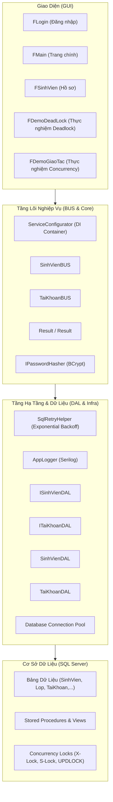

# 🎓 QLHSSV - Enterprise Student Profile Management & Database Concurrency System

[](https://dotnet.microsoft.com/)
[](https://learn.microsoft.com/en-us/dotnet/csharp/)
[](https://www.microsoft.com/sql-server)
[]()
[]()
[]()

Hệ thống **Quản lý Hồ sơ Sinh viên (QLHSSV)** kết hợp nền tảng **Nghiên cứu & Thực nghiệm Kiểm soát Giao tác Đồng thời (Concurrency Control & Deadlock Mitigation)** trên Microsoft SQL Server và .NET.

Dự án được tái cấu trúc từ đồ án môn học lên chuẩn **Enterprise Production-Ready**, tuân thủ các nguyên lý **SOLID**, áp dụng **Dependency Injection**, **Result Pattern**, **Deadlock Auto-Retry Resilience Policy**, **Bảo mật BCrypt** và hệ thống **Unit Testing toàn diện (xUnit + Moq + FluentAssertions)**.

---

## 🌟 Điểm Nhấn Kỹ Thuật (Key Technical Highlights)

### 1. 🛡️ Cơ Chế Xử Lý Deadlock Hai Tầng (Two-Tier Deadlock Mitigation)
- **Tầng Database (Phòng ngừa - Deadlock Prevention):** Triển khai giao thức **Ordering All the Items Protocol** (chuẩn hóa thứ tự tranh chấp tài nguyên Lớp -> Sinh viên) triệt tiêu hoàn toàn chu trình chờ (Circular Wait).
- **Tầng Application (Khôi phục - Deadlock Resilience):** Xây dựng `SqlRetryHelper` tự động bắt mã lỗi SQL `1205 (Deadlock Victim)` và `1222 (Lock Timeout)`, tự phục hồi bằng thuật toán **Exponential Backoff với Random Jitter**, đảm bảo tính khả dụng của hệ thống.

### 2. ⚡ Mô Phỏng Trực Quan Hiện Tượng Tranh Chấp Đồng Thời (Concurrency Anomalies)
Mô phỏng 4 hiện tượng bất thường kinh điển trong cơ sở dữ liệu và phương án cô lập (Isolation Levels):
- **Dirty Read (Đọc rác):** Xử lý bằng `READ COMMITTED`.
- **Unrepeatable Read (Đọc không lặp lại):** Xử lý bằng `REPEATABLE READ`.
- **Phantom Read (Bóng ma):** Xử lý bằng `SERIALIZABLE` hoặc `SNAPSHOT ISOLATION`.
- **Lost Update (Mất dữ liệu cập nhật):** Xử lý bằng Pessimistic Lock (`UPDLOCK`) hoặc Optimistic Concurrency.

### 3. 🔐 Bảo Mật BCrypt & Di Trú Không Gián Đoạn (Zero-Downtime Migration)
- Mật khẩu được băm bằng thuật toán chuẩn công nghiệp **BCrypt** với Work Factor = 11.
- Cơ chế **Seamless Legacy Migration**: Tự động nhận diện tài khoản kế thừa (Plaintext), xác thực an toàn và âm thầm băm nâng cấp lên BCrypt ngay trong lần đăng nhập đầu tiên mà không làm gián đoạn người dùng.

### 4. 🏛️ Kiến Trúc Phân Tầng Hiện Đại & Nguyên Lý SOLID
- Tách biệt hoàn toàn `GUI` ➔ `BUS (Business Logic)` ➔ `DAL (Data Access Layer)` qua các Interface (`ISinhVienDAL`, `ITaiKhoanDAL`,...).
- Khởi tạo và quản lý vòng đời đối tượng tập trung qua **.NET Dependency Injection Container (`IServiceCollection`)**.
- Áp dụng **Result Pattern (`Result<T>`)** giúp code sạch sẽ, tường minh, tránh lạm dụng exceptions cho business flow.
- Tích hợp **Serilog** ghi log cấu trúc xoay vòng (Rolling File Log) chuẩn Production.

### 5. ✅ Kiểm Thử Tự Động (Unit Testing)
- Bộ test tự động với **22/22 kịch bản pass 100%**:
  - `PasswordHasherTests`: Kiểm tra băm BCrypt, xác thực mật khẩu, kiểm thử cơ chế Zero-Downtime Migration.
  - `SinhVienValidationTests`: Kiểm tra các quy tắc nghiệp vụ (tuổi, CCCD, Email Regex, SĐT), cô lập Mock DAL qua `Moq`.
  - `SqlRetryHelperTests`: Kiểm định chính sách tự phục hồi khi xảy ra sự cố cơ sở dữ liệu.
  - `ResultPatternTests`: Kiểm thử tính toàn vẹn của kết quả trả về.

---

## 📐 Kiến Trúc Hệ Thống (Architecture)



---

## 🗄️ Cấu Trúc Thư Mục (Project Structure)

```text
├── Nhóm_8 Quản Lý Hồ Sơ Sinh Viên/
│   ├── QLHSSV_Nhóm8/                  # Dự án chính (.NET WinForms)
│   │   ├── Core/
│   │   │   ├── Common/                 # AppConfig, Result Pattern
│   │   │   ├── DI/                     # Dependency Injection Container
│   │   │   └── Security/               # BCrypt Password Hasher
│   │   ├── Infrastructure/
│   │   │   ├── Logging/                # Serilog Structured Logger
│   │   │   └── Resilience/             # Deadlock Retry Helper
│   │   ├── BUS/                        # Business Logic Layer (Sinh viên, Khoa, Lớp, Tài khoản)
│   │   ├── DAL/                        # Data Access Layer & Interfaces
│   │   ├── DTO/                        # Data Transfer Objects
│   │   ├── GUI/                        # WinForms UI Components
│   │   ├── appsettings.json            # Centralized Configuration
│   │   └── Program.cs                  # Application Bootstrap & Global Handlers
│   ├── QLHSSV.Tests/                   # Dự án Unit Tests (xUnit + Moq)
│   │   ├── Business/                   # SinhVienValidationTests
│   │   ├── Security/                   # PasswordHasherTests
│   │   ├── Resilience/                 # SqlRetryHelperTests
│   │   └── Common/                     # ResultPatternTests
│   ├── DatabaseObjects.sql             # Script tạo Bảng, Views, Stored Procedures
│   ├── Data.sql                        # Dữ liệu mẫu (Seed Data)
│   ├── Deadlock.sql                    # Kịch bản thực nghiệm Deadlock
│   └── Transaction.sql                 # Kịch bản thực nghiệm Concurrency Anomalies
├── INTERVIEW_PREP.md                   # Bộ câu hỏi & cẩm nang phỏng vấn tuyển dụng
└── README.md                           # Tài liệu tổng quan dự án
```

---

## 🚀 Hướng Dẫn Cài Đặt & Chạy Dự Án (Quick Start)

### 1. Yêu Cầu Môi Trường
- [.NET 10.0 SDK](https://dotnet.microsoft.com/download) trở lên.
- Microsoft SQL Server (hoặc SQL Server LocalDB đi kèm Visual Studio).
- Visual Studio 2022 / Visual Studio Code / JetBrains Rider.

### 2. Thiết Lập Cơ Sở Dữ Liệu
Mở SQL Server Management Studio (SSMS) hoặc Azure Data Studio và thực thi lần lượt các file:
1. `DatabaseObjects.sql` để tạo database `QLHSSV`, các bảng, trigger, view và stored procedures.
2. `Data.sql` để nạp dữ liệu mẫu ban đầu.

### 3. Cấu Hình Ứng Dụng
Kiểm tra chuỗi kết nối trong file `QLHSSV_Nhóm8/appsettings.json`:
```json
{
  "ConnectionStrings": {
    "DefaultConnection": "Server=(localdb)\\MSSQLLocalDB;Database=QLHSSV;Integrated Security=True;TrustServerCertificate=True;"
  }
}
```

### 4. Chạy Kiểm Thử Tự Động (Run Tests)
```bash
dotnet test
```
*Kết quả:* Toàn bộ 22 unit tests sẽ được thực thi và hiển thị trạng thái `Passed`.

### 5. Khởi Chạy Ứng Dụng
```bash
dotnet run --project ".\Nhóm_8 Quản Lý Hồ Sơ Sinh Viên\QLHSSV_Nhóm8\QLHSSV_Nhóm8.csproj"
```
- **Tài khoản mặc định:** `admin` / `123456`
- Hệ thống sẽ tự động băm nâng cấp mật khẩu sang BCrypt ngay trong lần đăng nhập đầu tiên.

---

## 👨‍💻 Tác Giả & Liên Hệ
- Đồ án được nâng cấp và hoàn thiện với định hướng ứng tuyển vị trí **.NET Backend / Software Engineer**.
- Tham khảo tài liệu cẩm nang phỏng vấn chi tiết tại: [INTERVIEW_PREP.md](./INTERVIEW_PREP.md).

